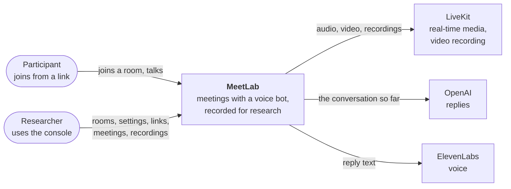
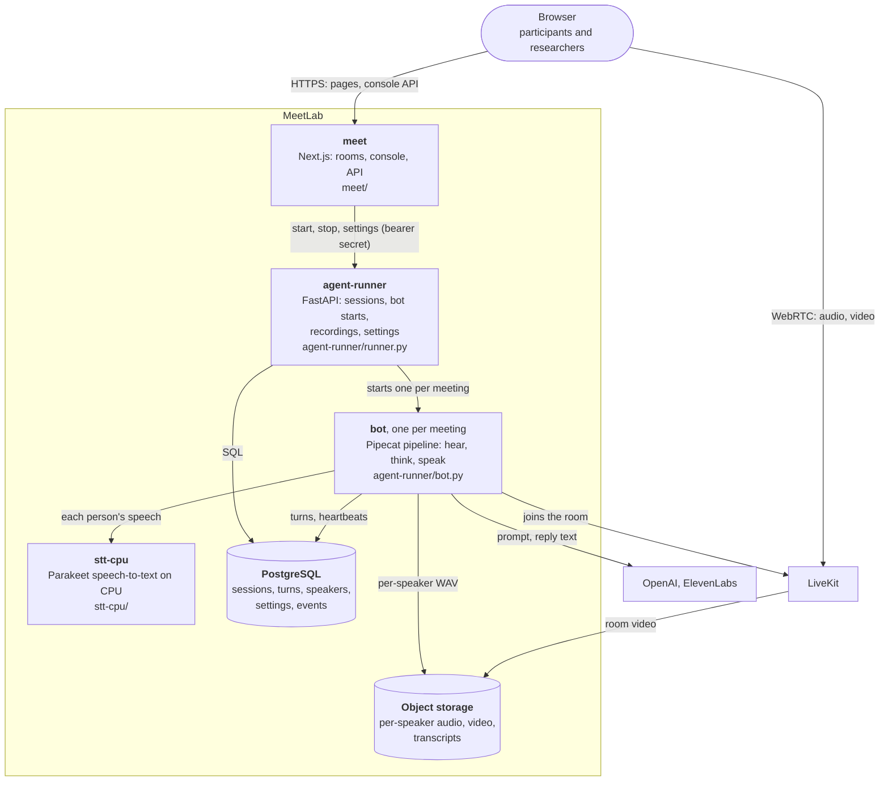
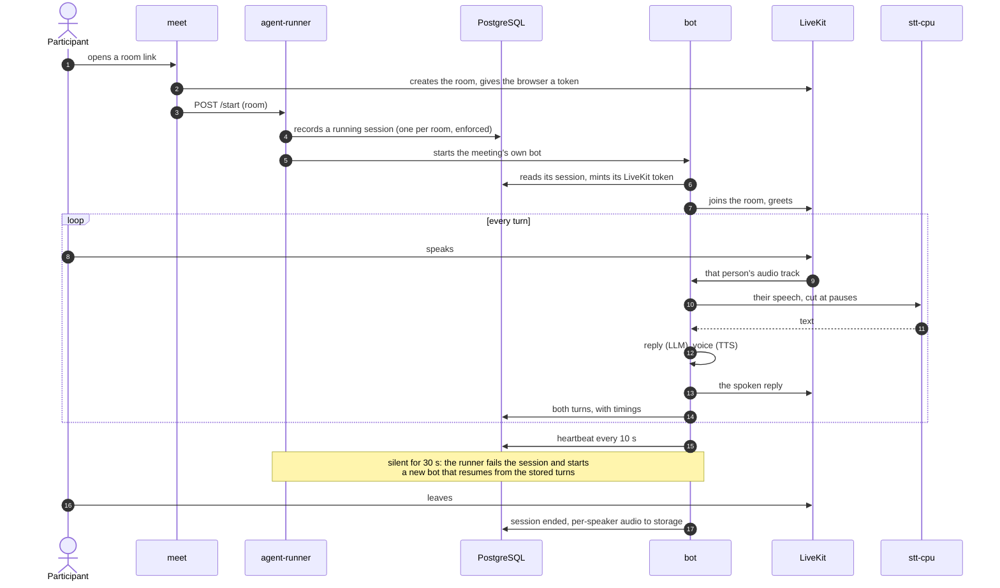

# MeetLab

Browser video meetings with a voice AI participant, recorded for research.

People join a room from a link. A bot joins with them, hears each person on a separate
speech-to-text stream, and answers by voice. Every session is stored: each speaker's turns
with timings, per-speaker audio, and the room's video.

- **Per-speaker listening:** overlapping speakers are transcribed as themselves.
- **One bot per meeting, isolated:** a crashed bot is replaced within a minute and continues
  the conversation from the stored turns.
- **A console for researchers:** rooms, past meetings and transcripts, bot settings per room,
  one-time participant links, an event log, and a database browser.
- **Study support:** participant IDs, session time limits, completion codes.

## Contents

- [Quick start](#quick-start)
- [Architecture](#architecture): C4 context, C4 containers, sequence diagram
- [Design decisions](#design-decisions)
- [Repository layout](#repository-layout)
- [Development](#development)
- [Deployment](#deployment)
- [Contributing](#contributing)
- [Documentation](#documentation)

## Quick start

**Prerequisites:** Docker (with Compose), `make`, and an OpenAI API key.

```bash
cp agent-runner/.env.runner.example agent-runner/.env.runner   # set OPENAI_API_KEY
cp meet/.env.local.example meet/.env.local                     # set CONSOLE_PASSWORD and BOT_RUNNER_SECRET
make start                                                     # build, start, run migrations
```

| URL | What it is |
|---|---|
| <http://localhost:3000> | The console (sign in with `CONSOLE_PASSWORD`) |
| `http://localhost:3000/rooms/<name>` | A meeting room |
| <http://localhost:7860/health> | The bot runner's health check |

Open a room, then press **Start bot** for it in the console. `make stop` shuts everything down.
The local stack runs the same images and the same speech-to-text server as production, with
its own LiveKit server; bots start as Docker containers.

## Architecture

### C4 level 1: System context



### C4 level 2: Containers



In production each bot is an ECS task and object storage is S3; locally each bot is a Docker
container and recordings go to a local folder.

### Sequence diagram: one meeting



## Design decisions

The full record, with the measurements and dates behind each one, is the decision log in
[infra/LEDGER.md](infra/LEDGER.md#decisions).

| Decision | Why | Consequence |
|---|---|---|
| **One bot process per meeting** | One faulty bot can't affect other meetings | Bots scale with meetings; a dead bot is detected by heartbeat and replaced |
| **The database owns session state**: one running session per room, enforced by a constraint | Restarts of the web or runner services lose nothing | A second start for a room is refused (409) |
| **A speech-to-text stream per participant** | Overlapping speech stays attributed to the right person | More streams per room; capped per room, and a participant past the cap is refused, not degraded |
| **Self-hosted speech-to-text on CPU** (Parakeet) | Same accuracy as the GPU build, ~15 ms slower at p95, no per-minute fee, audio stays in our cloud | A GPU only pays off past ~100 concurrent rooms |
| **Managed LiveKit for media and recording** | Cheaper than self-hosting at research volumes | A self-hosted LiveKit setup exists in Terraform as a switch |
| **Sized for actual use, scaled on request** | Real use is a few hours a month | Capacity comes from measured load tests: [docs/infrastructure.md](docs/infrastructure.md) |
| **Infrastructure as code, deployed only by CI** | No drift; every change is reviewed | Production changes only through a release tag and an approval |
| **No staging environment** | The local stack mirrors production | Live tests run against production after every release |
| **Least-privilege roles, secrets outside the repo** | Contain mistakes and leaks | Each role is checked against a permission contract before live tests |
| **Tests first** | Each bug fix lands with the test that failed first | Static, unit, integration, contract and live levels ([docs/testing.md](docs/testing.md)) |

## Repository layout

| Path | What it is |
|---|---|
| [`meet/`](meet) | Next.js app: meeting rooms, the console, its API |
| [`agent-runner/`](agent-runner) | Python: the runner API, the bot pipeline, database models and migrations |
| [`stt-cpu/`](stt-cpu) | The CPU speech-to-text server |
| [`infra/stack/`](infra/stack) | Terraform for the AWS deployment |
| [`infra/bootstrap/`](infra/bootstrap) | Terraform for CI's own permissions (applied by a maintainer) |
| [`.devcontainer/`](.devcontainer) | The local Docker Compose stack |
| [`docs/`](docs) | Documentation site (`make docs`) |
| [`CLAUDE.md`](CLAUDE.md) | A map of the code for contributors and coding agents |

## Development

```bash
make start / make stop       # the local stack
make logs SERVICE=agent-runner
make test                    # unit and integration tests against the running stack
make test-unit               # unit tests only
make test-static             # dead code, image size, docs, lint, types, workflows, scripts
make test-infra              # Terraform tests, offline
make docs                    # the documentation site
```

The runner has no hot reload: `docker compose -f .devcontainer/docker-compose.yml restart agent-runner`
after editing Python. Test levels and pass criteria: [docs/testing.md](docs/testing.md).

## Deployment

MeetLab runs on AWS (ECS, RDS, S3) from the Terraform in [`infra/stack`](infra/stack), deployed
only by GitHub Actions:

1. **Pull request:** tests run, and CI posts a read-only Terraform plan.
2. **Merge to `main`:** tests run again and images are built. Nothing is deployed.
3. **Release:** a `v2.x.y` tag on a green `main` commit. After a maintainer approves, CI applies
   the plan and runs live tests.

Set-up, secrets, releasing and operating: [docs/deployment.md](docs/deployment.md).

## Contributing

1. Branch from `main` and open a pull request into `main`.
2. Write the failing test first; keep `make test`, `make test-static` and `make test-infra` green.
3. Use [Conventional Commits](https://www.conventionalcommits.org/) (`feat(bot): …`, `fix(console): …`).
4. Never commit secrets or participant data. Configuration goes in env files (local) or a secret
   store (cloud).
5. A new Bot settings field goes in three places (model and migration, runner API, console form);
   `make test-config-parity` checks this.

## Documentation

| Topic | Where |
|---|---|
| Capacity: what to run for N rooms | [docs/infrastructure.md](docs/infrastructure.md) |
| Deploying and operating | [docs/deployment.md](docs/deployment.md) |
| Testing | [docs/testing.md](docs/testing.md), [docs/load-testing.md](docs/load-testing.md) |
| Event log | [docs/event-log.md](docs/event-log.md) |
| Session limits, study support | [docs/session-limits.md](docs/session-limits.md), [docs/study-support.md](docs/study-support.md) |
| Decisions, costs, measurements | [infra/LEDGER.md](infra/LEDGER.md) |
| v1 history | tag [`v1.0.0`](../../tree/v1.0.0), [docs/v1-to-v2-migration.md](docs/v1-to-v2-migration.md) |
