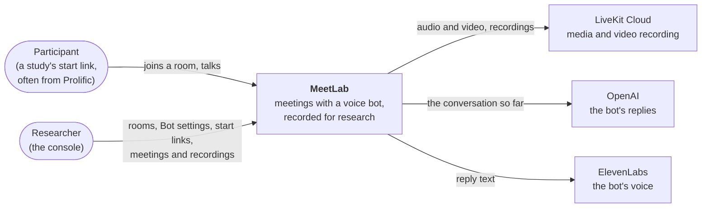
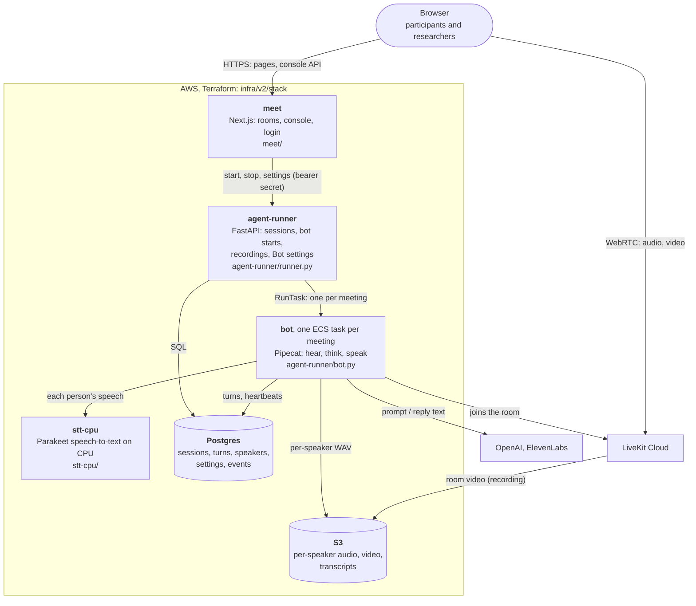
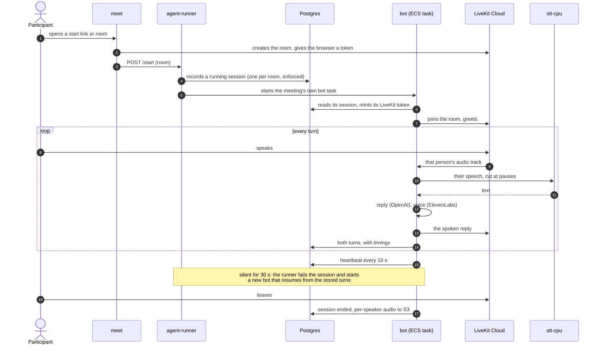

# MeetLab

Browser meetings with a voice assistant, recorded for research. A participant joins a room from
a link; a bot hears each person separately and answers; every session is stored (turns per
speaker, per-speaker audio, video) for the study team.

## Start here

| | |
|---|---|
| **Production** | <https://meet.wwbp.org>: the console at `/` (login: SSM `/meetlab-v2/prod/CONSOLE_PASSWORD`), rooms at `/rooms/<name>` |
| **Code** | `main` is MeetLab v2, live since 2026-10-14. v1 is the tag [`v1.0.0`](https://github.com/wwbp/MeetLab/tree/v1.0.0) (archive branch `v1`) |
| **Ship a change** | PR into `main` → merge (tests, images; production untouched) → release tag `v2.x.y` → your approval → production + live tests. [How](#ship-a-change) |
| **Run it locally** | `make start`, then <http://localhost:3000>. [Quick start](#quick-start-local) |
| **Decisions, costs, measurements** | [infra/v2/LEDGER.md](infra/v2/LEDGER.md) (every decision and manual action, with dates) |
| **Never** | release during a study; change AWS by hand (Terraform and GitHub Actions only, except the steps the ledger lists); put a secret in the repo or Terraform |

New here? Read this page top to bottom, then [CLAUDE.md](CLAUDE.md) (the code's map) and
[docs/v2-infrastructure.md](docs/v2-infrastructure.md) (the capacity decision matrix: what to run for N rooms).

## The lay of the land

**Who uses it and what it talks to** (C4, level 1: system context):



**What runs where** (C4, level 2: containers; all in AWS `us-east-1`, defined in
[infra/v2/stack](infra/v2/stack)):



**One meeting, start to end** (the code is in [CLAUDE.md](CLAUDE.md#how-a-meeting-runs)):



## Major design decisions

Each has its reasons, numbers and date in the [ledger](infra/v2/LEDGER.md).

| Decision | Why |
|---|---|
| **One bot per meeting, in its own container** (an ECS task; a Docker container locally) | One bad bot can't stop other meetings. A killed bot is detected in under 60 s and replaced by one that continues the conversation |
| **The database decides who has a bot**: one running session per room, enforced by Postgres | A restart of meet or the runner loses nothing; a second Start is refused (409) |
| **Each participant has their own speech-to-text stream** | Overlapping speakers are heard as themselves; the per-speaker audio is kept |
| **Speech-to-text is ours** (Parakeet on CPU) | Same accuracy as the GPU version (only 15 ms slower at p95), no per-minute fee, audio stays in our AWS |
| **Media and video recording on LiveKit Cloud** (Ship plan) | Cheaper than running our own until ~55–60 recorded room-hours a month; 100 recordings at once |
| **Small by default, scaled on request**: one warm bot machine (5 rooms); *Prepare for study* adds machines | Real use is a few hours a month. Sizes come from measured load tests ([capacity_model.py](agent-runner/capacity_model.py)): 84 rooms within every pass criterion, 100 started at once |
| **Everything in Terraform, deployed only by GitHub Actions**: a release tag plus a reviewer's approval for production | No drift, every change reviewed; CI's own permissions are in [infra/v2/bootstrap](infra/v2/bootstrap), applied by a person, so CI can't widen them |
| **One production, no staging** | The local stack mirrors production (same images, same speech-to-text); live tests run on production after every release |
| **Secrets only in AWS SSM; least-privilege roles**, checked by a permission contract before each live test run | A role can do exactly what the code calls, nothing more ([permission_contract.py](agent-runner/tests/permission_contract.py)) |
| **Tests first**, at every level ([docs/testing.md](docs/testing.md)) | Static, unit, integration, contract, live meetings on production; each bug fix lands with the test that failed first |

## Quick start: local

**Prerequisites:** Docker Desktop, an OpenAI API key, `make`.

```bash
cp agent-runner/.env.runner.example agent-runner/.env.runner   # add OPENAI_API_KEY
cp meet/.env.local.example meet/.env.local                     # set CONSOLE_PASSWORD + BOT_RUNNER_SECRET
make start                                                     # build, start, migrate
```

| URL | What it is |
|-----|-----------|
| <http://localhost:3000> | The console (sign in with `CONSOLE_PASSWORD`) |
| `http://localhost:3000/rooms/<name>` | A meeting room |
| <http://localhost:7860/health> | agent-runner health |

The local stack runs the same images as production, with its own LiveKit and the same CPU
speech-to-text server; bots start as Docker containers. Then:

```bash
make test           # unit + integration tests against the running stack
make test-static    # dead code, image size, docs, lint, types, workflows, scripts
make test-infra     # Terraform tests, offline
make docs           # the documentation site
```

## Quick start: cloud

Production already exists; you change it through GitHub, never by hand.

### Ship a change

1. **PR into `main`.** CI runs every test and posts a read-only Terraform plan of production.
   Read it: a "destroy" or "replace" on the database, bucket or load balancer needs a second look.
2. **Merge.** CI runs the tests again and builds the images, tagged with the commit.
   Production is not touched.
3. **Release.** Tag a green `main` commit and push the tag:
   ```bash
   git fetch origin && git tag v2.1.2 origin/main && git push origin v2.1.2
   ```
   In GitHub, *Actions → Release v2 → Review deployments → Approve*. Production is updated,
   then live tests hold real meetings on meet.wwbp.org. **Never release during a study.**

### Look at production

- **The console:** <https://meet.wwbp.org> (Meetings, Events, Bot settings, Start links,
  Database).
- **Logs:** CloudWatch, `/meetlab-v2/prod/<meet|agent-runner|bot|stt-cpu>`.
- **Secrets:** SSM `/meetlab-v2/prod/*`.
- **Before a study:** check the ElevenLabs quota (a used-up quota makes a silent bot) and press
  *Prepare for study* about 10 minutes before.
- **First-time AWS set-up and the steps only a person does** (bootstrap roles, secrets, the
  recording key): [docs/v2-deployment.md](docs/v2-deployment.md).

## The console

- **Rooms**: create rooms, start and stop bots, record video, prepare for a study.
- **Meetings**: past sessions with transcripts, per-speaker audio and recordings.
- **Events**: the durable event log (errors and admin actions).
- **Bot settings**: the bot's prompt, greeting, models, voice and timing, globally or per room.
- **Start links**: one link per participant for a study.
- **Database ↗**: SQLAdmin over Postgres (console login required).

## Good to know

- **Recording.** Video is recorded by LiveKit (locally the `egress` container writes to
  `recordings/`; production records through LiveKit Cloud into S3). Per-speaker audio is
  written by the bot itself and survives a failed video recording. With auto-record on, a session
  that can't get a recorder within 10 minutes shows a failed recording.
- **Participant cap.** One room admits `MAX_PARTICIPANT_WORKERS` speech-recognition streams
  (default 6). A **new** participant past that is refused, not silently degraded (an overload
  once dropped replies from 261 to 23), and it is logged as a WARNING in the event log.
- **Bot identity** is any participant whose identity starts with `bot_`.
- **meet keeps some display state in memory** (track subscriptions); a restart resets those
  views, not sessions.
- **v1's data** (its real sessions, 266 of 661; our own test runs left out) moved into v2 on
  2026-10-14 and was checked row by row; v1's database snapshots and an archive of its files are
  kept ([docs/v1-to-v2-migration.md](docs/v1-to-v2-migration.md)).
