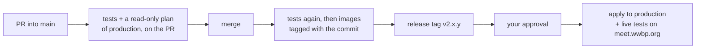

# Deploying and operating

Every AWS resource is in Terraform under `infra/`, and GitHub Actions deploys it. Nobody
clicks around the AWS console or runs `terraform apply` against production by hand. This
page is what you need the first time you deploy, how to look after production, and the few
steps a **person** has to do because the pipeline is deliberately not allowed to.

## Operating production

| | |
|---|---|
| **Production** | <https://meet.wwbp.org>: the console at `/`, rooms at `/rooms/<name>` |
| **Console login** | SSM parameter `/meetlab-v2/prod/CONSOLE_PASSWORD` |
| **Logs** | CloudWatch, `/meetlab-v2/prod/<meet\|agent-runner\|bot\|stt-cpu>` |
| **Secrets** | SSM `/meetlab-v2/prod/*`, never in the repo or Terraform state |
| **Code** | `main`; v1 is the tag `v1.0.0` (archive branch `v1`, never merge into it) |
| **Decisions, costs, manual actions** | [`infra/LEDGER.md`](https://github.com/wwbp/MeetLab/blob/main/infra/LEDGER.md) |

- **Never release during a study**, and never change AWS by hand: Terraform and GitHub Actions
  only, apart from the steps under *Things only a person does* (log each in the ledger).
- **Before a study:** check the ElevenLabs quota (a used-up quota makes a silent bot, with no
  error), and press *Prepare for study* in the console about 10 minutes before.
- **Bigger studies:** the decision matrix in [infrastructure.md](infrastructure.md) says what
  to change for N rooms.

## How a deploy happens

There is one production and no staging (since 2026-10-14). Merging builds; only a release
deploys, after your approval.



1. Open a PR into `main`. CI runs the unit and Terraform tests and posts a plan of
   **production** as a comment. **Read the plan**: anything "destroy" or "replace" on the
   database, bucket or load balancer deserves a second look.
2. **Merging deploys nothing.** It runs the tests again and builds the images, tagged with
   the commit. Production is untouched until a release.
3. A release (next section) deploys a green build's images to production after your
   approval, then the live tests run real meetings on meet.wwbp.org: a bot joins, is
   stopped several ways, is killed, and recordings land in S3. A red live test means
   production is live but broken: look at it at once.
4. Test locally before a release (`make start`, `make test`): the local stack mirrors
   production. A release restarts production's services, so **never release during a
   study.**

Watch merges under **Actions → Build**, releases under **Actions → Release**.

## Releasing to production

Production runs the **same images the merge built and tested**, never a new build. A release
is a git tag on a `main` commit whose Build run (tests and images) is green:

```bash
git fetch origin && git tag v2.1.2 origin/main && git push origin v2.1.2
```

Then, under **Actions → Release**:

1. **staged** checks the commit is on `main` and that its "Build" build succeeded. If not,
   it stops: release a commit whose build passed.
2. **deploy** waits for **your approval** (the `production` environment; only `v2.*` tags
   may use it). Once approved, it tags the images with the release (release images never
   expire), applies `infra/stack` as production, and runs the live tests against
   production (`infra/live-tests.sh prod`).

A release restarts production's services: **never release during a study.** Number
releases `v2.MAJOR.MINOR.PATCH`; v1 stays as `v1.0.0`. To go back, release the earlier tag's
commit again under a new tag.

The live tests hold real meetings on production (rooms named `accept-…`), using the paid
vendors for a few minutes. After the cutover, those rooms are test data in production's
database; the console lists them like any other room.

## Things only a person does

**Log every one of these** in the "Manual actions" table in
[`infra/LEDGER.md`](https://github.com/wwbp/MeetLab/blob/v2/infra/LEDGER.md):
when, who, what, why. Never the secret itself.

The pipeline's roles can't change their own permissions, can't read v1, and
can't create access keys. That's on purpose; these steps are the price.

### 1. Bootstrap (once, and whenever CI needs new permissions)

`infra/bootstrap/` holds the CI roles and the permissions boundary. It is
applied from a laptop by someone with admin rights in the AWS account:

```bash
cd infra/bootstrap
terraform init
terraform plan     # read it: only meetlab-v2-* roles and policies should change
terraform apply
```

When a PR changes `bootstrap/`, apply it **before** merging that PR, or the
pipeline will fail with "AccessDenied".

### 2. Secrets (once)

Vendor keys live in SSM Parameter Store under `/meetlab-v2/prod/`. They are never in
Terraform or in the repo. Production's are in place; to fill a fresh environment
(generates what it can, puts placeholders for the recording key, prints no values):

```bash
infra/seed-secrets.sh prod
```

### 3. The video-recording key for LiveKit

LiveKit Cloud records the room on *its* servers and uploads the mp4 to our bucket,
so it needs an AWS access key. Terraform creates a user for this,
`meetlab-v2-<env>-egress-writer`, that can **only add files under
`recordings/`** — it can't read, list or delete anything. Terraform does **not**
create its key (a key in Terraform would sit in the state file). You mint it:

```bash
# once the egress user exists (after the environment's first deploy)
env=prod
aws iam create-access-key --user-name meetlab-v2-$env-egress-writer \
  --query 'AccessKey.[AccessKeyId,SecretAccessKey]' --output text \
| { read -r id secret
    aws ssm put-parameter --name /meetlab-v2/$env/EGRESS_S3_KEY_ID     --type SecureString --overwrite --value "$id"
    aws ssm put-parameter --name /meetlab-v2/$env/EGRESS_S3_KEY_SECRET --type SecureString --overwrite --value "$secret"; }
aws ecs update-service --cluster meetlab-v2-$env --service meetlab-v2-$env-agent-runner --force-new-deployment >/dev/null
```

The key goes straight into SSM and is never shown. agent-runner hands it to
LiveKit with each recording request, so there is nothing to paste into LiveKit's
dashboard.

!!! warning "Order matters"
    agent-runner won't start if those two parameters are missing (ECS can't
    fetch the secret), so `seed-secrets.sh` puts placeholders in first. On an
    environment's first deploy the video-recording live tests therefore fail; mint
    the key (above: the last line restarts agent-runner so it reads the key), then
    re-run the deploy's live tests.

**Rotating the key:** create a second key (a user may have two), write it to SSM
with the command above, redeploy agent-runner, then delete the old key with
`aws iam delete-access-key`.

### 4. The NVIDIA key, for the GPU speech-to-text server (once)

Only needed if production switches to the GPU server (below). NVIDIA's registry needs a key to
download the server and its model; it is in Secrets Manager as `meetlab-v2/prod/ngc`, in the shape
ECS expects for a private registry (`{"username": "$oauthtoken", "password": "<NGC key>"}`).
Development use is covered by NVIDIA's free developer program; production use needs an NVIDIA AI
Enterprise licence (ledger).

## Switching optional parts on and off

Production's sizes and switches are its profile in `infra/stack/profiles.tf`. Every change is
a PR, a merge, then a **release** (a merge alone deploys nothing). Never change the defaults in
`variables.tf` for this. What to switch, and when, is the decision matrix in
[infrastructure.md](infrastructure.md).

| Switch | Profile setting | Notes |
|---|---|---|
| Bigger speech-to-text machine | `stt_cpu_instance_type` | c6i.xlarge past 26 rooms, c6i.2xlarge past 53 |
| Speech-to-text on a GPU (Parakeet NIM) | `stt_nim_enabled = true`, `stt_cpu_enabled = false` | an on-demand `g6.xlarge` ($0.805/hour), the smallest that fits the model (13.75 GB of GPU memory); it **builds its model for 20–30 minutes** before it answers, so switch a day early |
| Our own LLM and voice (Qwen on vLLM, Kokoro) | `model_services = ["llm", "tts"]` | one `g6.xlarge` each; a room uses them by choosing `Qwen/Qwen2.5-7B-Instruct` and the `kokoro` voice provider in Bot settings; the `our_models` live test checks them |
| Self-hosted LiveKit and video recording | `livekit_self_hosted = true`, `egress_count = N` | each recorder is a `c6i.2xlarge` ($0.34/hour) and records about 3 rooms; with no recorder up, a recording request fails at once (the bot still records each speaker's audio) |

## Running the live tests yourself

The same tests CI runs, from your laptop:

```bash
CONSOLE_PASSWORD=... LIVEKIT_URL=... LIVEKIT_API_KEY=... LIVEKIT_API_SECRET=... \
caffeinate -i uv run --no-project --with livekit --with livekit-api --with boto3 --with playwright \
  python agent-runner/tests/acceptance_staging.py video_recording
```

Leave out the scenario name to run all of them. `turn_relay` drives a real Chromium; install
it once with `uvx --with playwright playwright install chromium`. Offline infra tests:
`make test-infra`.

## Gotchas we've hit

| Symptom | Cause | What to do |
|---|---|---|
| Live tests time out at random from a laptop | The Mac slept; signatures and sockets expired | `caffeinate -i`, or rely on the CI acceptance job |
| `pnpm test:api` fails tests with 429 | Start-link rate limit, 5 per minute | Wait a minute between runs |
| Local `make start` can't bind port 3000 | Another app holds it | Stop the other app, then `docker compose ... up -d --force-recreate meet` |
| Local tests pass/fail on code you already changed | Dev containers serve stale mounts | Restart the container before trusting a result |
| Bot joins but never speaks, no errors | ElevenLabs quota used up | Check the ElevenLabs subscription before blaming the deploy |
| Pipeline "AccessDenied" right after a merge | The PR needed bootstrap permissions that weren't applied yet | Apply bootstrap (step 1), re-run the job |
| Bot containers left running locally | A bot alone in a room waits 15 min for someone to arrive (`BOT_ARRIVAL_GRACE_SECONDS`) | `make down` cleans them up sooner |
| Bot machines never go away; console says a machine "is stuck shutting down" | Someone stopped or terminated an ECS machine by hand. ECS can't finish draining a stopped machine, so Auto Scaling waits forever and the pool can't shrink (2026-10-02: 27 h, two idle machines) | **Never stop or terminate ECS machines by hand**; scale through the console or Terraform. To unstick: `aws autoscaling complete-lifecycle-action --auto-scaling-group-name meetlab-v2-staging-bots --lifecycle-hook-name ecs-managed-draining-termination-hook --instance-id <id> --lifecycle-action-result CONTINUE`, then log it under Manual actions |
